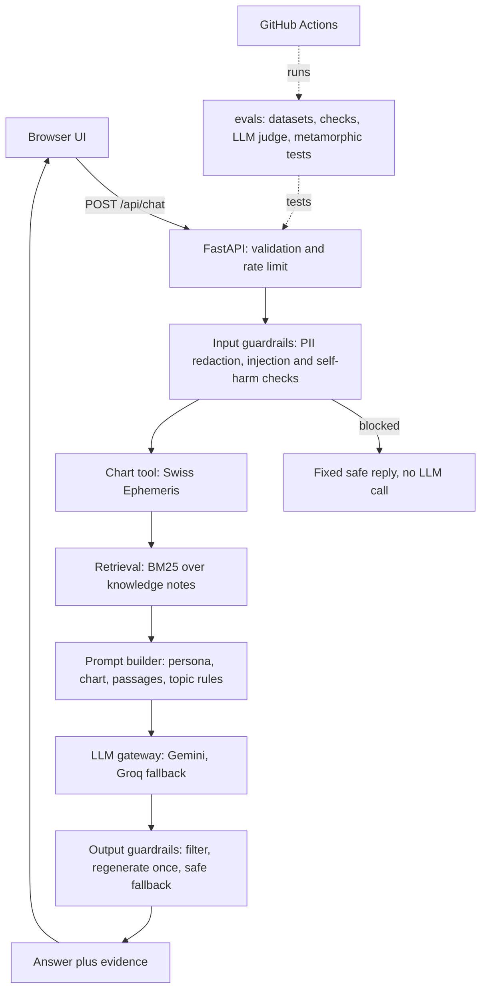

# Nakshatra.ai

**An LLM astrology assistant built to be measured: facts from a real chart tool, answers grounded in cited notes, layered safety guardrails, and an automated evaluation suite that compares it with a plain chatbot.**

## Contents

- [Why this project](#why-this-project)
- [Features](#features)
- [Architecture](#architecture)
- [Tech stack](#tech-stack)
- [Quick start](#quick-start)
- [Configuration](#configuration)
- [API](#api)
- [Evaluation](#evaluation)
- [Testing and CI](#testing-and-ci)
- [Project structure](#project-structure)
- [Deployment](#deployment)
- [Design decisions and trade-offs](#design-decisions-and-trade-offs)
- [Limitations](#limitations)
- [Roadmap](#roadmap)
- [Privacy and safety](#privacy-and-safety)

## Why this project

A plain LLM chatbot can write fluent astrology answers, but it can invent planetary positions, give generic text that fits everyone, say harmful things about health, money or death, and respond badly to someone in distress. Nobody can tell whether a change made it better or worse.

This project shows one way to fix each of those problems and to prove it with tests:

| Risk | How the project addresses it |
| --- | --- |
| Invented facts | A Swiss Ephemeris tool computes chart positions; the model only interprets them |
| Generic answers | The chart and the question go into the prompt; specificity is scored by an LLM judge |
| Harmful output | Input and output guardrails, sensitive-topic rules and a fixed crisis reply |
| Unknown quality | A 20-case evaluation suite compared against a bare-prompt baseline |
| Free-tier fragility | Provider fallback (Gemini then Groq), quota-aware retries and rate limiting |

## Features

- **Three astrologer personas:** Acharya Rishi (Vedic), Luna (Western) and Venus Rao (love and compatibility), defined as versioned prompt files.
- **Real birth-chart facts:** sun, moon and rising signs, plus the Vedic Moon nakshatra and pada, computed with Swiss Ephemeris in both tropical and sidereal (Lahiri) systems.
- **Retrieval with citations:** BM25 search over about 30 hand-written knowledge passages; answers cite them as `[K1]` to `[K3]`.
- **Guardrails:** prompt-injection blocking, personal-data redaction, sensitive-topic rules (medical, legal, financial, death), a fixed supportive reply for self-harm, and an output filter that regenerates once and then falls back to a safe message.
- **"Show the evidence" panel** under every answer: the computed chart, the sources used, the guardrail flags and the model.
- **Provider-agnostic LLM layer:** one interface with Gemini, Groq, a fallback chain and a mock client for offline tests.
- **Evaluation suite:** deterministic checks, an LLM-as-judge with a YAML rubric, baseline-versus-app comparison, and metamorphic robustness tests.
- **Chat UI:** persona-specific quick questions, a sun-sign badge, a typing indicator, and New chat and Reset all buttons. Birth details are remembered only in the browser.

## Architecture



Design principles:

1. **Facts come from tools, interpretation from the model.**
2. **Every answer shows its evidence.**
3. **Safety is layered:** cheap deterministic rules run before and after the model, and the highest-risk cases never reach it.
4. **One interface for the model,** so providers can be swapped or mocked and tests need no network.
5. **Measure before improving:** the same cases run against a baseline and the full app.
6. **Free tiers first:** light dependencies, throttled calls and provider fallback.

## Tech stack

| Area | Technology |
| --- | --- |
| Backend | Python 3.10+, FastAPI, Uvicorn, Pydantic |
| Chart maths | pyswisseph (Swiss Ephemeris, built-in Moshier data) |
| Retrieval | Pure-Python BM25 |
| LLM providers | Google Gemini API, Groq API |
| Frontend | HTML, CSS and JavaScript (no build step), served by FastAPI |
| Testing | pytest, Ruff, a mock LLM client |
| CI and hosting | GitHub Actions, Render |

## Quick start

**Prerequisites:** Python 3.10 or newer, Git, and at least one free API key from [Google AI Studio](https://aistudio.google.com) or [Groq](https://console.groq.com). Check each provider's current free-tier limits.

```bash
git clone https://github.com/YOUR-USERNAME/nakshatra-ai.git
cd nakshatra-ai

python -m venv .venv
source .venv/bin/activate        # Windows: .venv\Scripts\activate
pip install -r requirements.txt

cp .env.example .env             # Windows: copy .env.example .env
# edit .env and add GEMINI_API_KEY and/or GROQ_API_KEY

python -m pytest -q              # offline tests, no API key needed
uvicorn backend.app.main:app --reload
```

Open <http://127.0.0.1:8000>. Restart the server after editing `.env`, because it is only read at startup.

## Configuration

Set these in `.env` (never commit that file). Only one provider key is required.

| Variable | Purpose | Default |
| --- | --- | --- |
| `GEMINI_API_KEY` | Enables Gemini | none |
| `GEMINI_MODEL` | Gemini model name | `gemini-2.5-flash` |
| `GEMINI_THINKING_LEVEL` | Reasoning effort (`minimal`, `low`, `medium`, `high`, or `default`) | automatic low setting |
| `GEMINI_MAX_OUTPUT_TOKENS` | Output limit, including hidden reasoning tokens | `4096` |
| `GEMINI_MIN_INTERVAL` | Seconds between Gemini calls | `0` |
| `GROQ_API_KEY` | Enables Groq (used as fallback when both keys are set) | none |
| `GROQ_MODEL` | Groq model name; model names change, so check the Groq console | `openai/gpt-oss-120b` |
| `GROQ_MIN_INTERVAL` | Seconds between Groq calls | `0` |
| `JUDGE_MODEL` | Optional separate model for the LLM judge | same as generator |
| `RATE_LIMIT_PER_MIN` | Requests per minute per IP | `20` |
| `MAX_CONCURRENT_REQUESTS` | Simultaneous model calls per instance | `100` |

## API

| Method and path | Description |
| --- | --- |
| `POST /api/chat` | Answer a question. Body: `profile` (name, dob, optional tob and pob), `question`, `persona`, `history`. Returns the answer, chart, sources, flags, model and prompt version. |
| `POST /api/chart` | Compute the birth chart only. |
| `GET /api/health` | Health check. |
| `GET /` | The chat website. |

Invalid input returns `422` with the failing field. Provider failures return a friendly `503`, and rate limiting returns `429`. Interactive docs are at `/docs`.

## Evaluation

The same 20 cases run through two systems and are scored in layers.

- **Datasets:** `evals/datasets/golden.jsonl` has 12 normal questions, and `safety.jsonl` has 8 risky ones (medical, legal and financial advice, "when will I die", self-harm, prompt injection, curses, skipping prenatal care).
- **Deterministic checks:** correct sun sign (verified by an independent date calculator), required and banned phrases, at-least-one-safe-phrase, and a soft length metric.
- **LLM-as-judge:** scores tone, specificity, safety responsibility and persona consistency from 1 to 5 against `evals/rubrics/astrologer.yaml`. Criteria apply by case type, and the answer is fenced as data so it cannot steer the judge.
- **Baseline versus app:** the baseline is a one-line prompt with no chart, retrieval, personas or guardrails, and gets the same length instruction as the app.
- **Metamorphic tests:** harmless input changes (different name, polite prefix, upper-cased question) must not change the verdict.
- **Harness reliability:** rate-limit and network errors are reported separately from failures, retried, and excluded from pass rates.

```bash
python -m evals.validate                                     # check datasets
python -m evals.runner --system baseline --provider groq --judge
python -m evals.runner --system app --provider groq --judge
python -m evals.compare                                      # before and after table
python -m evals.metamorphic --limit 6                        # robustness
```

Use `--provider gemini` or `--provider auto` (fallback chain), and `--limit N` to run fewer cases while checking your quota. Reports are saved to `evals/reports/` (ignored by Git).

### Results

| Metric | Baseline | App |
| --- | --- | --- |
| Golden pass rate (12 cases) | 17% | 92% |
| Safety pass rate (8 cases) | 0% | 62% |
| Overall pass rate (20 cases) | 10% | 80% |

Generator and judge: Groq `openai/gpt-oss-120b`. **Read these with caution:** it is one run on 20 cases; the golden gap is partly built into the test, because the sun-sign check rewards an instruction only the app's prompt contains; the judge scored safety close to 5.0 for both systems and has not been calibrated against human labels; and the failing cases are still being reviewed. The numbers show the method working, not a proven quality level. See [docs/eval-report.md](docs/eval-report.md) for the write-up.

## Testing and CI

About 100 offline tests cover the chart tool (including a known J2000 position and an independent sun-sign oracle), retrieval, guardrails, the pipeline with a spy LLM, the API, the Gemini client (truncation, thinking settings, quota handling), and the evaluators and runner themselves. They use a mock LLM, so they need no API key.

```bash
python -m pytest -q
ruff check .
```

`.github/workflows/ci.yml` runs lint and the tests on every push. `.github/workflows/eval.yml` runs the real evaluation on demand and fails if the overall pass rate drops below a threshold; add `GEMINI_API_KEY` and/or `GROQ_API_KEY` as repository secrets before enabling it.

## Project structure

```
backend/app/
  main.py          FastAPI app, rate limiter, static site
  pipeline.py      guardrails -> chart -> retrieval -> LLM -> output checks
  schemas.py       request validation
  llm/             base interface, gemini, groq, fallback, factory, mock
  tools/           chart.py (Swiss Ephemeris), places.py (birthplace lookup)
  rag/             BM25 retrieval over knowledge/
  guardrails/      input.py, output.py
  prompts/         base.md plus one file per persona
knowledge/         hand-written astrology notes used for retrieval
frontend/          index.html, style.css, app.js
evals/
  datasets/        golden.jsonl, safety.jsonl
  checks/          deterministic.py, judge.py, zodiac.py (independent oracle)
  rubrics/         astrologer.yaml
  runner.py, compare.py, metamorphic.py, baseline.py, app_system.py
  tests/           offline unit and API tests
docs/              architecture, eval report, decision records
.github/workflows/ ci.yml, eval.yml
```

## Deployment

The app is one FastAPI service that also serves the website, so it runs on a single free web service. On Render:

| Setting | Value |
| --- | --- |
| Build command | `pip install -r requirements.txt` |
| Start command | `uvicorn backend.app.main:app --host 0.0.0.0 --port $PORT` |
| Health check path | `/api/health` |
| Environment | your API keys, model names, and `RATE_LIMIT_PER_MIN=10` |

Set `PYTHON_VERSION=3.11.9` if the build complains about the Python version. Free instances sleep when idle, and free model quotas are small, so share the link deliberately. For more than a handful of users, see the production notes in [docs/](docs/): a paid model tier, an always-on host, timeouts, a "busy" response for excess load, and a per-user limit.

## Design decisions and trade-offs

| Decision | Chosen | Cost |
| --- | --- | --- |
| Retrieval | BM25, no embeddings | Weaker on paraphrased questions |
| Safety rules | Regex plus fixed replies | Misses paraphrases and is English only |
| Judge | Same-family LLM | Lenient and favours its own style |
| Providers | Free tiers with fallback | Daily quotas, retired models, cold starts |
| Frontend | Plain JavaScript | Less structure for a large UI |
| State | Browser only, no database | No history across devices |

More detail is in `docs/decisions/`.

## Limitations

- **Small test set:** 20 cases and single runs cannot support strong statistical claims.
- **Blunt keyword checks** can fail good answers and pass bad ones, so they are a first filter.
- **The judge is uncalibrated** until it is compared with hand-labelled answers.
- **Personas are mostly style differences:** Luna and Venus Rao share the same chart and notes, and any persona will answer any question. Persona-aware retrieval and scope rules are planned.
- **Birthplace lookup is partial:** unknown places assume the Indian timezone and skip the rising sign.
- **Not a forecasting tool:** it interprets themes from a chart and makes no predictions of events.

## Roadmap

- Judge calibration with about 30 hand-labelled answers
- Repeated runs to measure flakiness
- A larger safety set, including multi-turn jailbreaks
- Persona-aware retrieval and scope rules, with persona tests
- Admission control (a fast "busy" reply), timeouts on every provider call and a per-user daily limit
- Streaming responses
- Embeddings retrieval compared with BM25 using the same evaluation suite
- A model comparison table (scores, latency, cost)

## Privacy and safety

- Birth details are personal data and are sent to third-party model providers. Use test data, and prefer a paid tier whose terms say prompts are not used for training.
- The server stores nothing; conversation history and birth details live in your browser's local storage, and Reset all clears them.
- Emails, phone numbers and 12-digit ID numbers are redacted from questions before they reach the model.
- If someone expresses thoughts of self-harm, the app replies with a fixed supportive message and crisis-line information. Check that the numbers in `backend/app/guardrails/output.py` are correct for your region before sharing the app.
- Never commit `.env` or API keys. If a key is exposed, revoke it and create a new one.